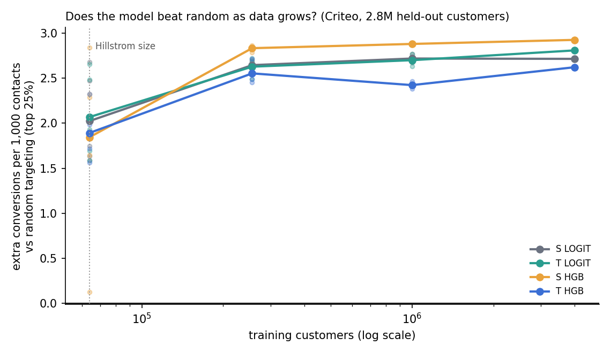

# Criteo scale replication (pre-registered protocol v4)

*Generated from `results.json`; nothing here is typed by hand.* Protocol: `data/eval/criteo_protocol_v4_scale.json` (committed before any model was fitted).

**Why.** Hillstrom has 64,000 customers; a power calculation says about 284,000 are needed to settle whether the model beats random. Criteo's randomized advertising data has **13,979,592 rows** (85% treated, 0.292% conversion), so the same question can be asked with real power. It is a different, anonymised, advertising setting: a **methodological replication, not evidence about Hillstrom customers**.

**Design.** 20% of rows (2,795,918; 8,129 conversions) held out once as TEST. Four fixed-setting candidates trained on random subsets of the other 80% at four sizes (5, 3, 2, 1 independent draws). Metric: extra conversions per 1,000 contacts among the top 25% by score, minus the same estimator on the whole test set (random reference). Paired customer bootstrap, 100 resamples. Accuracy is not reported (conversion is about 0.3%).

Whole-test average effect of the exposure: **1.15** extra conversions per 1,000 contacts.

## Result: gap versus random (top 25%), mean over draws (draws whose 95% interval is above zero)

| training customers | train conversions | S_LOGIT | T_LOGIT | S_HGB | T_HGB |
|---|---|---|---|---|---|
| 64,000 | ~187 | +2.02 (5/5) | +2.07 (5/5) | +1.85 (4/5) | +1.89 (5/5) |
| 256,000 | ~738 | +2.65 (3/3) | +2.63 (3/3) | +2.83 (3/3) | +2.55 (3/3) |
| 1,000,000 | ~2,942 | +2.72 (2/2) | +2.70 (2/2) | +2.88 (2/2) | +2.42 (2/2) |
| 4,000,000 | ~11,801 | +2.72 (1/1) | +2.81 (1/1) | +2.93 (1/1) | +2.62 (1/1) |

## Reading (pre-registered rules)

Under the pre-registered majority rule, candidates beat random targeting already at the Hillstrom-sized training set (n_64k; mean gap +1.96 per 1,000), and the gap grows only modestly with 60x more training data (mean +2.77 at n_4m). **Training-set size is therefore not what limits the Hillstrom result.** The test set is the difference: here it has 2,795,918 customers and the 95% interval half-width is about 0.37 per 1,000, while the Hillstrom test split has 25,603 customers and its interval half-width is about 6 per 1,000, larger than any plausible gap. Interpretation (not separately tested): Hillstrom's 'not stable' verdict is mostly an evaluation-power limit, and this dataset's signal is also stronger. Criteo does not show that Hillstrom's model works; it shows that the method can detect targeting value when the test is large enough.

No challenger beat the S_LOGIT baseline under the pre-registered paired rule.

## Limits

- One dataset, one split seed, fixed hyper-parameters at every size (no tuning, by design).
- The Criteo features are anonymised, so no business interpretation of *who* is targeted is possible.
- Advertising exposure, not an e-mail; conversion is a site conversion. No profit claim is made.
- Bootstrap intervals describe sampling noise of the test split for a given fitted model; they do not include training-set variation, which is why several independent draws are reported at the smaller sizes.
- Run time 11 minutes; reproduce with `python -m mi.campaign.scale` (hash-checked raw file required).
